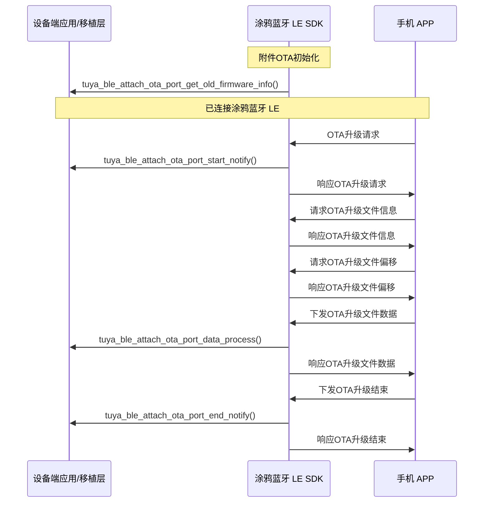

# 附件 OTA

# 附件 OTA
## 概述

### 概念

OTA（Over-the-Air）指通过无线通信方式对设备固件进行远程升级的技术。

在涂鸦蓝牙方案中，设备支持通过蓝牙对主控蓝牙芯片或模组的固件进行 OTA 升级。除此之外，若设备还包含其他需要通过蓝牙升级的**附件**，则可通过「附件 OTA」功能对这些附件进行 OTA 升级。**附件**指通过蓝牙与主控芯片或模组连接、且需独立固件升级的子设备，例如：外挂传感器、从机模组、外设 MCU 等。

### 附件通道号

涂鸦蓝牙模组的主固件 OTA 默认使用通道号 0，因此在一般情况下无需特别指定。但考虑到一个设备可能挂载多个需要升级的附件，需要为每个附件分配独立的通道号以区分不同的升级任务。

各升级类型与通道号对应关系如下：

| 升级类型     | 通道号 | 说明                                             |
| ------------ | ------ | ------------------------------------------------ |
| 主固件 OTA   | 0      | 默认，无需指定                                   |
| 外部 MCU OTA | 9      | 涂鸦蓝牙通用对接架构中常用，无需指定             |
| 附件 OTA     | 10～19 | 最多 10 个附件，每个附件占用一个通道，需手动指定 |

目前，涂鸦蓝牙附件通道号支持的范围为 10～19，最多可支持 10 个附件。开发者需注意：

- 在 IoT 平台创建附件 OTA 任务时，必须明确指定所使用的附件通道号。
- 设备端在处理附件 OTA 时，也需要根据对应的通道号执行正确的升级流程。

### 注意事项

* 附件 OTA 的升级流程与主固件 OTA 基本一致，两者的核心区别仅在于所使用的通道号不同（主固件默认为 0，附件使用 10～19）。因此在数据接收、解析、处理等环节，附件 OTA 完全复用主固件 OTA 的代码逻辑。
* 外部 MCU 升级单独作为一种升级方案，固定使用通道号 9。在涂鸦蓝牙通用对接架构方案中，常用该通道作为外部 MCU 的固件升级通道。
* 使用附件 OTA 通道时，建议**从通道号 10 起按 10、11、12… 顺序使用**，避免跳号（如仅用 10 和 15），以降低移植与排查难度；且**仅定义满足功能所需的最少通道个数**，未使用的附件 OTA 通道会占用 SRAM 资源。

### 附件OTA流程

**前置条件**：进行附件 OTA 前，须在应用层调用 `tuya_ble_device_update_attach_version()` 上报当前附件版本信息，否则 APP 侧无法正确发起或校验升级。



### 快速接入步骤

1. **使能功能**：在工程中定义 `TUYA_BLE_FEATURE_ATTACH_OTA_ENABLE (1)`，并配置 `TUYA_BLE_ATTACH_OTA_PORT_NUM`（所需附件通道个数，1～10）。
2. **实现 Port 层**：在 `tal_ble_attach_ota_port.c` 中，参考已有代码，实现四个回调：`tuya_ble_attach_ota_port_get_old_firmware_info()`、`tuya_ble_attach_ota_port_start_notify()`、`tuya_ble_attach_ota_port_data_process()`、`tuya_ble_attach_ota_port_end_notify()`。
3. **协议回调中按通道号分发**：在 `TUYA_BLE_CB_EVT_OTA_DATA` 中根据 `event->ota_data.p_data[0]` 区分：0 走主固件 OTA，10～19 走附件 OTA（调用 `tuya_ble_attach_ota_handler()`）。
4. **上报附件版本**：蓝牙连接建立后或附件信息变更后，调用 `tuya_ble_device_update_attach_version()` 上报当前附件版本信息，以便 APP 判断是否有新版本可升级。

## 数据结构

### tuya_ble_ota_data_type_t

```c
typedef enum {
    TUYA_BLE_OTA_REQ,
    TUYA_BLE_OTA_FILE_INFO,
    TUYA_BLE_OTA_FILE_OFFSET_REQ,
    TUYA_BLE_OTA_DATA,
    TUYA_BLE_OTA_END,
    TUYA_BLE_OTA_UNKNOWN,
} tuya_ble_ota_data_type_t;
```

* `TUYA_BLE_OTA_REQ`：请求启动 OTA。
* `TUYA_BLE_OTA_FILE_INFO`：读取 OTA 文件信息。
* `TUYA_BLE_OTA_FILE_OFFSET_REQ`：读取 OTA 文件偏移信息。
* `TUYA_BLE_OTA_DATA`：写入 OTA 数据。
* `TUYA_BLE_OTA_END`：OTA 升级结束。
* `TUYA_BLE_OTA_UNKNOWN`：未知状态。

### tuya_ble_ota_data_t

```c
typedef struct {
    tuya_ble_ota_data_type_t type;
    UINT16_T data_len;
    UINT8_T *p_data;
} tuya_ble_ota_data_t;
```

* `type`：详见 `tuya_ble_ota_data_type_t`。
* `data_len`：OTA 数据长度（字节）。
* `p_data`：OTA 数据内容。**首字节为通道号**（0=主固件，10～19=附件），后续为各 OTA 阶段对应的 payload；解析具体类型（FILE_INFO、DATA 等）时需从 `p_data[1]` 起解析。

### TUYA_OTA_FIRMWARE_INFO_T

```c
typedef struct {
    UINT32_T len;
    UINT32_T crc32;
    UINT8_T  md5[TUYA_OTA_FILE_MD5_LEN];
} TUYA_OTA_FIRMWARE_INFO_T;
```

* `len`：固件长度（字节）。
* `crc32`：固件 CRC32 校验值。
* `md5`：固件 MD5，长度为 `TUYA_OTA_FILE_MD5_LEN`（一般为 16 字节）。

### TUYA_BLE_ATTACH_OTA_INFO_T

```c
typedef struct {
    UINT32_T type:8;
    UINT32_T version:24;
    TUYA_OTA_FIRMWARE_INFO_T firmware_info;
} TUYA_BLE_ATTACH_OTA_INFO_T;
```

* `type`：附件类型（如产品定义的附件类型 ID）。
* `version`：附件固件版本号（24 bit）。
* `firmware_info`：当前固件信息，类型为 `TUYA_OTA_FIRMWARE_INFO_T`。

## 接口说明

### 代码文件

```shell
tal_ble_attach_ota
├── include
│   └── tuya_ble_attach_ota.h
└── src
    └── tuya_ble_attach_ota.c
```

### 附件OTA宏定义配置

| 宏定义     | TUYA_BLE_FEATURE_ATTACH_OTA_ENABLE                           |
| ---------- | ------------------------------------------------------------ |
| **依赖项** | 无                                                           |
| **描述**   | 使能 “附件OTA” 功能：`#define TUYA_BLE_FEATURE_ATTACH_OTA_ENABLE (1) `<br />禁用 “附件OTA” 功能：`#define TUYA_BLE_FEATURE_ATTACH_OTA_ENABLE (0) ` |
| **备注**   |                                                              |

### 附件OTA通道个数配置

| 宏定义     | TUYA_BLE_ATTACH_OTA_PORT_NUM                                 |
| ---------- | ------------------------------------------------------------ |
| **依赖项** | 先使能 `TUYA_BLE_FEATURE_ATTACH_OTA_ENABLE` 宏定义           |
| **描述**   | 定义附件 OTA 的通道个数。                                    |
| **备注**   | 外部 MCU 固定使用通道 9，会固定占用1个配置个数。若不需要附件 OTA，可设为 1 或不使用附件 OTA 通道；若需要附件 OTA，则至少为 2，最大为 11（对应通道 10～19）。 |

### 附件OTA信息更新接口

| 函数原型     | tuya_ble_status_t tuya_ble_device_update_attach_version(VOID_T* buf, UINT32_T size) |
| ------------ | ------------------------------------------------------------ |
| **功能概述** | 更新附件的版本信息；                                         |
| **参数说明** | buf[in]：附件 OTA 信息数据指针，传入的数据需为 `TUYA_BLE_ATTACH_OTA_INFO_T` 结构体数组；<br />size[in]：buf 中有效附件信息的个数（即 `TUYA_BLE_ATTACH_OTA_INFO_T` 的个数），范围 0～10；为 0 表示不上报或当前无附件。 |
| **返回值**   | TUYA_BLE_SUCCESS：发送成功；失败时返回相应错误码（如参数非法、未使能附件 OTA 等）。 |
| **备注**     | 应在蓝牙连接建立后或附件信息变更后调用，APP 会据此判断是否有新版本可升级。 |

### 附件OTA回调事件

| 回调事件     | TUYA_BLE_CB_EVT_OTA_DATA                                     |
| ------------ | ------------------------------------------------------------ |
| **数据结构** | tuya_ble_ota_data_t                                          |
| **描述**     | APP下发附件OTA升级相关数据                                   |
| **备注**     | 固件 OTA 与附件 OTA 共用同一回调事件，通过 **event->ota_data.p_data[0]** 区分：0 表示固件 OTA，10～19 表示附件 OTA。解析具体 OTA 类型（FILE_INFO、DATA 等）时需**跳过首字节**，从 `p_data[1]` 起解析。**处理前请校验** `event->ota_data.p_data != NULL` 且 `event->ota_data.data_len >= 1`。 |

```c
STATIC VOID_T tuya_ble_protocol_callback(tuya_ble_cb_evt_param_t* event)
{
    switch (event->evt)
    {
        //...
        case TUYA_BLE_CB_EVT_OTA_DATA: {
            if (event->ota_data.p_data == NULL || event->ota_data.data_len < 1) {
                break; /* 非法数据，忽略 */
            }
            if (event->ota_data.p_data[0] == 0) {
                #if defined(TUYA_BLE_FEATURE_OTA_ENABLE) && (TUYA_BLE_FEATURE_OTA_ENABLE == 1)
                tuya_ble_ota_handler(&event->ota_data);
                #endif
            } else {
                #if defined(TUYA_BLE_FEATURE_ATTACH_OTA_ENABLE) && (TUYA_BLE_FEATURE_ATTACH_OTA_ENABLE == 1)
                tuya_ble_attach_ota_handler(&event->ota_data);
                #endif
            }
        } break;
        //...
    }
}
```

## 使用方法

以下接口由涂鸦 SDK 在附件 OTA 流程中回调，需开发者在 `tal_ble_attach_ota_port` 中实现；未实现的接口可返回 `OPRT_OK` 或相应错误码。

### 代码文件

```shell
tal_ble_attach_ota_port
├── include
│   └── tuya_ble_attach_ota_port.h
└── src
    └── tuya_ble_attach_ota_port.c
```

### 获取已有附件OTA信息接口

| 函数原型     | OPERATE_RET tuya_ble_attach_ota_port_get_old_firmware_info(TUYA_OTA_FIRMWARE_INFO_T **info) |
| ------------ | ------------------------------------------------------------ |
| **功能概述** | 获取已有附件 OTA 信息。                                      |
| **参数说明** | info[out]：已有附件 OTA 信息数据指针。                       |
| **返回值**   | OPRT_OK：成功；失败时返回相应错误码。                        |
| **备注**     | 实现断点续传时，需在此返回已存储的附件固件信息给 info。若当前无已存储信息（如首次烧录），可将 *info 置为 NULL 或返回错误，表示不支持断点续传、本次为全量升级。 |

### 附件OTA升级启动通知接口

| 函数原型     | OPERATE_RET tuya_ble_attach_ota_port_start_notify(UINT_T image_size, TUYA_OTA_TYPE_E type, TUYA_OTA_PATH_E path) |
| ------------ | ------------------------------------------------------------ |
| **功能概述** | APP 向设备发送附件 OTA 启动通知。                            |
| **参数说明** | image_size[in]：本次升级的固件大小（字节），若协议暂不传递则可能为 0；<br />type[in]：附件升级类型，目前固定为 1，表示全量升级；<br />path[in]：附件升级路径，目前固定为 2，表示通过蓝牙。 |
| **返回值**   | OPRT_OK：成功；若不允许升级可返回错误以中止流程。            |
| **备注**     | 可在此做升级前检查（如存储空间、附件是否在线），不满足条件时返回错误。 |

### 附件OTA升级数据处理接口

| 函数原型     | OPERATE_RET tuya_ble_attach_ota_port_data_process(TUYA_OTA_DATA_T *pack, UINT32_T *remain_len) |
| ------------ | ------------------------------------------------------------ |
| **功能概述** | APP 向设备发送附件 OTA 升级数据。                            |
| **参数说明** | pack[in]：APP 下发的附件 OTA 数据指针；<br />remain_len[in]：剩余待下发数据长度（字节），可用于进度显示或流控，无需时可忽略。 |
| **返回值**   | OPRT_OK：成功；失败时返回相应错误码。                        |
| **备注**     | 需将 pack 中的数据按序写入 Flash/存储并保证完整性；整包校验通常在 end_notify 或重启后执行。 |

### 附件OTA升级结束通知接口

| 函数原型     | OPERATE_RET tuya_ble_attach_ota_port_end_notify(BOOL_T reset) |
| ------------ | ------------------------------------------------------------ |
| **功能概述** | APP 向设备发送附件 OTA 结束通知。                            |
| **参数说明** | reset[in]：是否在升级完成后复位设备/附件；为 TRUE 时建议在完成校验与存储后执行复位，使新固件生效。 |
| **返回值**   | OPRT_OK：成功；校验失败时可返回错误并清理临时数据。          |
| **备注**     | 可在此做整包校验（如 CRC32/MD5），校验失败时返回错误并清理临时数据。 |

## IoT 平台配置说明

在涂鸦 IoT 平台上创建附件 OTA 任务时，需注意：

- **通道号**：选择或填写附件通道号（10～19），且需与设备端 `TUYA_BLE_ATTACH_OTA_PORT_NUM` 及实际使用的通道一致。
- **固件包与版本**：按平台要求上传固件包，并填写版本号等信息，版本号需与设备端上报的 `TUYA_BLE_ATTACH_OTA_INFO_T` 中的版本约定一致，以便 APP 判断是否需要升级。

具体配置步骤以平台当前说明为准，可参考涂鸦 IoT 平台 OTA 相关文档。

## 常见问题

| 现象                              | 建议排查                                                     |
| --------------------------------- | ------------------------------------------------------------ |
| APP 不显示附件 OTA 或无法发起升级 | 确认是否已调用 `tuya_ble_device_update_attach_version()` 上报附件版本；通道号是否与平台任务一致。 |
| 断点续传不生效                    | 检查 `tuya_ble_attach_ota_port_get_old_firmware_info()` 是否返回了已存储的固件信息（len/crc32/md5）。 |
| 升级失败或校验失败                | 检查 `tuya_ble_attach_ota_port_data_process()` 是否按序、完整写入存储；`end_notify` 中整包校验（CRC32/MD5）是否通过； |